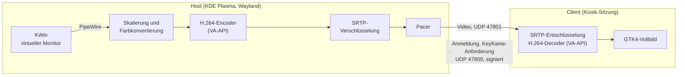

# opentop

[](LICENSE)

-1d99f3.svg)
-lightgrey.svg)

opentop macht aus Linux-Laptops zusätzliche Monitore für einen Rechner mit
KDE Plasma. Der Host legt für jeden verbundenen Laptop einen echten virtuellen
Monitor an und überträgt dessen Inhalt hardwarebeschleunigt und verschlüsselt
über das lokale Netzwerk. Auf dem Client-Laptop ist nach der Einrichtung keine
Bedienung mehr nötig: Er startet direkt in eine Vollbildanzeige und verbindet
sich selbstständig.

*English summary: opentop turns spare Linux laptops into additional monitors for
a KDE Plasma (Wayland) machine. The host creates one virtual output per client
via xdg-desktop-portal, encodes it with VA-API H.264 and streams it over SRTP.
Clients pair once by comparing a six-digit code and then boot straight into a
fullscreen kiosk session. The documentation below is in German.*

## Inhalt

- [Funktionen](#funktionen)
- [Funktionsweise](#funktionsweise)
- [Voraussetzungen](#voraussetzungen)
- [Installation](#installation)
- [Erste Schritte](#erste-schritte)
- [Konfiguration](#konfiguration)
- [Direkte Kabelverbindung](#direkte-kabelverbindung)
- [Windows als Host (experimentell)](#windows-als-host-experimentell)
- [Sicherheit](#sicherheit)
- [Fehlersuche](#fehlersuche)
- [Einschränkungen](#einschränkungen)
- [Projektstruktur](#projektstruktur)
- [Lizenz](#lizenz)

## Funktionen

**Anzeige**

- Echter virtueller Monitor in KDE Plasma, der sich in den Anzeige-Einstellungen
  wie ein physischer Bildschirm anordnen lässt.
- Ein eigener Monitor und Stream pro Client; mehrere Clients gleichzeitig.
- Automatische Anpassung an die Auflösung des Clients: Der Stream wird auf die
  Panel-Auflösung skaliert und die Skalierung des virtuellen Monitors so gewählt,
  dass Schrift in nativer Größe erscheint.
- Bis zu 60 Bilder pro Sekunde mit VA-API-Encoding und -Decoding.

**Verbindung**

- Automatische Erkennung im lokalen Netzwerk; der Monitor erscheint, sobald der
  Client erreichbar ist, und wird entfernt, wenn er verschwindet.
- Bevorzugung direkter Kabelverbindungen (IPv4-Link-Local) gegenüber dem LAN
  bzw. WLAN, mit unterbrechungsfreiem Wechsel.
- Gleichmäßiges Versenden der Pakete (Pacing), damit Switches vor langsameren
  Anschlüssen nicht überlaufen.
- Sofortige Anforderung eines neuen Keyframes bei Paketverlust.

**Sicherheit**

- Einmalige Kopplung über einen sechsstelligen Vergleichscode.
- Signierte Steuernachrichten mit Schutz gegen Wiederholung.
- Verschlüsselte Videoübertragung (SRTP) mit einem Schlüssel pro Client.

**Client**

- Eigene Login-Sitzung im Kiosk-Modus, optional mit automatischer Anmeldung.
- Wartebildschirm mit Hostname und IP-Adressen, solange keine Verbindung besteht.
- Ausgeblendeter Mauszeiger.
- Rückkehr zur Anmeldung per <kbd>Strg</kbd>+<kbd>Alt</kbd>+<kbd>Rücktaste</kbd>,
  um den Laptop wieder normal zu verwenden.

## Funktionsweise



Der Client meldet sich jede Sekunde per UDP-Broadcast mit seiner ID und
Bildschirmauflösung. Kennt der Host den Client, fordert er über das
ScreenCast-Portal einen virtuellen Monitor an, kodiert dessen Inhalt und sendet
ihn an die Adresse, von der die Anmeldung kam. Bleibt die Anmeldung sechs
Sekunden aus, wird der Monitor wieder entfernt.

## Voraussetzungen

|              | Host                                         | Client                                     |
|--------------|----------------------------------------------|--------------------------------------------|
| System       | Arch Linux mit KDE Plasma 6 unter Wayland; Windows 10/11 experimentell | Arch Linux, beliebige Desktop-Umgebung; Gentoo mit OpenRC ohne Desktop |
| Grafik       | GPU mit VA-API (sonst Software-Encoding)     | GPU mit VA-API empfohlen                   |
| Netzwerk     | Gleiches Subnetz wie der Client              | Gleiches Subnetz wie der Host              |

Getestete Konfiguration: Plasma 6.8 auf Intel Iris Xe als Host, Intel HD 505
(Pentium N4200, 1366 × 768) als Client, verbunden über ein kabelgebundenes LAN
mit 100 Mbit/s auf Client-Seite.

## Installation

Das Repository auf beiden Rechnern klonen:

```sh
git clone https://github.com/David-Birk/opentop.git
cd opentop
```

### Host

```sh
./install-host.sh
```

Das Skript installiert die benötigten Pakete, `opentop-host` nach
`~/.local/bin`, einen systemd-Benutzerdienst, der mit der Plasma-Sitzung startet,
sowie einen Menüeintrag **opentop**, der den Dienst ein- und ausschaltet.

### Client

```sh
./install-client.sh --autologin
```

Das Skript installiert die benötigten Pakete, `opentop-client` nach
`/usr/local/bin`, die Login-Sitzung „opentop (Zweiter Monitor)“ und ein
unsichtbares Cursor-Theme für diese Sitzung. Mit `--autologin` wird SDDM bzw.
LightDM so konfiguriert, dass der Laptop direkt in diese Sitzung startet. Ohne
die Option lässt sich die Sitzung im Anmeldebildschirm auswählen.

Der VA-API-Treiber wird nicht automatisch installiert, da er von der GPU
abhängt:

| GPU                         | Paket                |
|-----------------------------|----------------------|
| Intel ab Broadwell          | `intel-media-driver` |
| Intel vor Broadwell         | `libva-intel-driver` |
| AMD                         | in `mesa` enthalten  |

Ohne Treiber dekodiert der Client in Software, was auf schwachen Prozessoren zu
deutlichem Ruckeln führt.

Beide Skripte öffnen bei aktivem `firewalld` oder `ufw` die benötigten Ports.

### Client unter Gentoo/OpenRC (minimal)

Für Laptops, die ausschließlich zweiter Monitor sein sollen, gibt es mit
`opentop-client-kms` eine schlanke Variante. Sie braucht weder Desktop noch
Display-Manager, Compositor, GTK oder Mesa: Der Client läuft als
OpenRC-Dienst und gibt das Bild per `kmssink` direkt über DRM/KMS aus. Den
Wartebildschirm zeichnet GStreamer selbst (`textoverlay`). Für die Kopplung
genügt PyNaCl (libsodium) statt `python-cryptography`, sodass auch kein Rust
kompiliert werden muss.

```sh
./install-client-gentoo.sh          # als root
rc-service opentop-client start     # oder neu starten
```

Das Skript setzt die nötigen USE-Flags (GStreamer ohne OpenGL, X11 und
Wayland, mit VA-API) und schaltet `kmssink` für `gst-plugins-bad` per
`/etc/portage/env` ein, da Gentoo es sonst nicht baut. Außerdem installiert es
den VA-API-Treiber für Intel-GPUs und legt den Systembenutzer `opentop`
(Gruppen `video` und `input`) sowie den Dienst `opentop-client` an. Optionen
stehen in `/etc/conf.d/opentop-client`.

| Option         | Zweck                                                          |
|----------------|----------------------------------------------------------------|
| `--link IFACE` | NetworkManager-Profil mit Link-Local-Adresse für ein Kabel      |
| `--user NAME`  | anderer Benutzer für den Dienst                                |
| `--software`   | zusätzlich Software-Decoder (ffmpeg) installieren              |
| `--start`      | Dienst sofort starten                                          |

`Strg`+`Alt`+`Rücktaste` beendet den Client und gibt Bildschirm und Tastatur
an die Konsole zurück. Das Protokoll landet per Syslog in
`/var/log/messages` (Kennung `opentop-client`). Falls `vah264dec` mit
DMABuf nicht ausgeben kann, weicht der Client automatisch auf `vapostproc`
bzw. Software-Decoding aus.

## Erste Schritte

### Kopplung

Ein Client muss einmalig mit dem Host gekoppelt werden:

1. Den Client starten. Der Wartebildschirm zeigt „Nicht gekoppelt“.
2. Sobald der Host den Client erkennt, zeigt der Client einen sechsstelligen
   Code an, und auf dem Host öffnet sich der Dialog „opentop – Kopplung“.
3. Stimmen die Codes überein, mit **Koppeln** bestätigen. Weichen sie ab, mit
   **Ablehnen** abbrechen.

Die Kopplung wird auf beiden Seiten gespeichert. Danach verbindet sich der
Client bei jedem Start automatisch.

### Betrieb

- **Monitor anordnen:** Systemeinstellungen → Anzeige → Ausgabe „Virtual…“.
  Plasma speichert die Position.
- **Host ein- und ausschalten:** Menüeintrag **opentop** oder
  `systemctl --user start|stop opentop-host`.
- **Client normal verwenden:** <kbd>Strg</kbd>+<kbd>Alt</kbd>+<kbd>Rücktaste</kbd>
  beendet die opentop-Sitzung. Im Anmeldebildschirm kann anschließend eine
  andere Sitzung gewählt werden. Nach einem Neustart startet per Autologin
  wieder opentop.
- **Autologin deaktivieren:** `/etc/sddm.conf.d/50-opentop.conf` entfernen.

### Kopplungen verwalten

```sh
opentop-host --list                   # gekoppelte Clients anzeigen
opentop-host --forget <name|id|all>   # Kopplung aufheben
```

Auf dem Client wird die Kopplung durch Löschen von
`~/.config/opentop/client.json` aufgehoben.

## Konfiguration

```
opentop-host   [--bitrate KBIT] [--fps N] [--software] [--no-autoscale]
               [--list] [--forget NAME|ID|all]
opentop-client [--host IP] [--latency MS] [--software]
```

| Option           | Programm | Beschreibung                                                          | Standard |
|------------------|----------|-----------------------------------------------------------------------|----------|
| `--bitrate`      | Host     | Ziel-Bitrate in kbit/s                                                | 10000    |
| `--fps`          | Host     | Maximale Bildrate                                                     | 60       |
| `--no-autoscale` | Host     | Skalierung des virtuellen Monitors nicht automatisch setzen           | aus      |
| `--software`     | beide    | Software-Encoder bzw. -Decoder statt VA-API verwenden                 | aus      |
| `--host`         | Client   | Host direkt adressieren statt per Broadcast, etwa über ein VPN        | –        |
| `--latency`      | Client   | Jitterbuffer in Millisekunden; für WLAN-Verbindungen etwa `30`        | 0        |

Host-Optionen werden über `systemctl --user edit opentop-host` gesetzt,
Client-Optionen in der `Exec=`-Zeile von
`/usr/share/wayland-sessions/opentop.desktop`.

## Direkte Kabelverbindung

opentop arbeitet auf IP-Ebene. Jede Verbindung, die Linux als Netzwerkschnittstelle
bereitstellt, ist geeignet:

- **Thunderbolt oder USB4** auf beiden Seiten mit passendem USB-C-Kabel
  (Schnittstelle `thunderbolt0`).
- **Ethernet-Kabel** direkt zwischen beiden Rechnern, gegebenenfalls über
  USB-Ethernet-Adapter.

Die Installationsskripte legen für `thunderbolt0` ein NetworkManager-Profil mit
Link-Local-Adressierung an. Für eine andere Schnittstelle wird deren Name als
Argument übergeben, zum Beispiel `./install-host.sh enp0s13f0u1u4`.

Ein gewöhnliches USB-Kabel zwischen zwei Laptops ist nicht geeignet, da beide
Geräte als USB-Host arbeiten.

## Windows als Host (experimentell)

Die Windows-Unterstützung befindet sich im Aufbau und wurde bisher nicht auf
Windows getestet. Kern, Kopplung und Verschlüsselung sind identisch mit der
Linux-Version; plattformspezifisch sind:

| Aufgabe              | Umsetzung unter Windows                                                    |
|----------------------|----------------------------------------------------------------------------|
| Virtueller Monitor   | [Virtual Display Driver](https://github.com/VirtualDrivers/Virtual-Display-Driver), Auflösung exakt passend zum Client |
| Bilderfassung        | `d3d11screencapturesrc`                                                    |
| Encoder              | Intel Quick Sync, NVIDIA NVENC, AMD AMF oder Media Foundation, automatisch gewählt |
| Kopplungsdialog      | Windows-Dialogfeld                                                         |
| Autostart            | Aufgabenplanung bei der Anmeldung                                          |
| Laufzeitumgebung     | MSYS2 (UCRT64) mit Python, PyGObject und GStreamer                         |

Installation (in einer PowerShell, für die Firewall-Regel als Administrator):

```powershell
powershell -ExecutionPolicy Bypass -File install-host-windows.ps1
```

Der Virtual Display Driver muss vorab von der
[Release-Seite](https://github.com/VirtualDrivers/Virtual-Display-Driver/releases)
installiert werden. Offene Punkte sind im Code mit `TODO(VM)` markiert.

## Sicherheit

**Kopplung.** Host und Client tauschen per X25519 einen Schlüssel aus. Der
Austausch wird durch einen sechsstelligen Vergleichscode abgesichert, nach dem
Prinzip von Bluetooth Numeric Comparison: Der Host legt sich über einen Hash auf
seine Zufallszahl fest, bevor er die des Clients kennt. Ein Angreifer zwischen
beiden Geräten erzeugt dadurch nur mit einer Wahrscheinlichkeit von 1 : 10⁶
übereinstimmende Codes, und die Kopplung erfordert zusätzlich die Bestätigung am
Host.

**Steuernachrichten.** Anmeldungen gekoppelter Clients sind mit HMAC-SHA256
signiert und enthalten eine fortlaufende Nummer. Gefälschte und wiederholt
gesendete Nachrichten werden verworfen.

**Video.** Die Übertragung erfolgt per SRTP (AES-128-ICM, HMAC-SHA1-80) mit
einem eigenen Schlüssel pro Client.

**Sichtbare Metadaten.** Die Anmeldung des Clients wird per Broadcast versendet
und enthält Hostname, Bildschirmauflösung und Client-ID. Andere Geräte im
Netzwerk können also erkennen, dass ein opentop-Client aktiv ist, nicht aber den
übertragenen Inhalt.

**Schlüsselablage.** `~/.config/opentop/` mit `host.key` und `clients.json` auf
dem Host bzw. `client.key` und `client.json` auf dem Client. Die Dateien sind nur
für den jeweiligen Benutzer lesbar.

**Ports.** UDP 47800 für Anmeldung und Kopplung (eingehend auf dem Host),
UDP 47801 für das Video (eingehend auf dem Client).

## Fehlersuche

Host und Client protokollieren alle fünf Sekunden eine Statistik:

```sh
journalctl --user -u opentop-host -f   # Host: Bildrate, Formate, Fehler
journalctl -t opentop-client -f        # Client: Pakete, Verluste, angezeigte Bilder
```

| Symptom                                     | Ursache und Abhilfe                                                                 |
|---------------------------------------------|-------------------------------------------------------------------------------------|
| Blockartefakte, falsche Farben, Bildreste   | Paketverlust. Bitrate senken, Kabel statt WLAN verwenden, bei WLAN `--latency 30`.  |
| Ruckeln, hohe CPU-Last am Client            | Kein VA-API-Treiber installiert, siehe [Installation](#client).                      |
| Kein Monitor erscheint                      | Host-Protokoll prüfen, Firewall für UDP 47800 prüfen, am Client `--host` setzen.     |
| Kein Kopplungsdialog                        | `kdialog` fehlt, oder eine Ablehnung ist noch aktiv (Host 5 min, Client 1 min).      |
| Schrift zu groß oder zu klein               | Skalierung in den Anzeige-Einstellungen anpassen und `--no-autoscale` setzen.       |
| Statistik zeigt weniger als 60 Bilder/s     | Erwartetes Verhalten: KWin liefert nur bei Bildänderungen neue Frames.              |

## Einschränkungen

- Unter Linux wird als Host nur KDE Plasma unterstützt, da andere Compositors
  über das ScreenCast-Portal derzeit keine virtuellen Monitore bereitstellen.
  Die Windows-Unterstützung ist experimentell.
- KDE erzeugt virtuelle Monitore mit fester Auflösung von 1920 × 1080. Bei
  Clients mit anderem Seitenverhältnis entstehen Ränder. Unter Windows besteht
  diese Einschränkung nicht.
- Eingaben am Client werden nicht an den Host weitergeleitet.
- Es wird kein Ton übertragen.

## Projektstruktur

| Datei                      | Zweck                                                        |
|----------------------------|--------------------------------------------------------------|
| `opentop-host`             | Startprogramm des Hosts, wählt das Backend                   |
| `opentop_host.py`          | Host-Kern: Kopplung, Sitzungen, Pipeline, Pacing             |
| `opentop_kde.py`           | Host-Backend für KDE Plasma (Portal, PipeWire, VA-API)       |
| `opentop_windows.py`       | Host-Backend für Windows (experimentell)                     |
| `opentop-client`           | Client: Kopplung, Empfang, Decoding, Vollbildanzeige         |
| `opentop-client-kms`       | Schlanker Client ohne Desktop, Ausgabe direkt per KMS        |
| `opentop_proto.py`         | Gemeinsames Protokoll und Kryptografie (cryptography oder PyNaCl) |
| `install-host.sh`          | Installation auf dem Host (Linux)                            |
| `install-host-windows.ps1` | Installation auf dem Host (Windows, experimentell)           |
| `install-client.sh`        | Installation auf dem Client                                  |
| `install-client-gentoo.sh` | Installation des KMS-Clients unter Gentoo/OpenRC             |
| `data/`                    | systemd- und OpenRC-Dienst, Menüeintrag und Login-Sitzung    |

## Lizenz

Veröffentlicht unter der MIT-Lizenz, siehe [LICENSE](LICENSE).
